<p align="center">
  
</p>

<p align="center">
  <a href="https://github.com/pranavvehmid/delt/releases/latest/download/DELT.apk">
    
  </a>
</p>

<p align="center">
  <a href="https://delt-mu.vercel.app"></a>
  <a href="https://github.com/pranavvehmid/delt/releases/latest"></a>
  <a href="#tests"></a>
  
</p>

DELT reads your VIT Gmail and sorts every mail into four piles, so exams, registrations, fees and deadlines are always at the top. It works for any `@vitstudent.ac.in` account and costs nothing to run.

<p align="center">
  
</p>

## How it sorts

<p align="center">
  
</p>

| Pile | What goes here |
|---|---|
| **Urgent** | exams, quizzes, CBTs, course and mock registration, FFCS, interviews, fee payments, anything with a deadline that applies to you |
| **Priority** | hackathons and contests, official notices: timetable changes, holidays, hostel and mess, transport, results |
| **Later** | achievements, guest lectures, webinars, club events, study-abroad programmes, scholarships |
| **Noise** | promotions, sales, admissions for other programmes |

Your register number (for example `26BCE…`) is in your Google name, so DELT knows your batch. Mail meant for other batches or seniors goes to Later.

If you move a mail to a different pile, DELT does the same for that sender from then on.

Most mail is sorted by simple rules. When the rules aren't sure, Google Gemini's free tier takes a second look.

## Using it

<p align="center">
  
</p>

- **Inbox** has every mail from the last 60 days, newest first. Filter by pile, show unread only, or search.
- **Tap a mail** to read the whole thing inside DELT. You can move it to another pile, add its deadline to Google Calendar, or mark it done.
- **Deadlines** lists the due dates found in your mail: overdue, today, tomorrow, this week, later.
- On a phone, swipe right to mark read, swipe left to mark done. You can undo either.

New mail is checked when you open the app, every 5 minutes while it's open, and once a day at 7 AM.

### Appearance

Tap ◐ in the top bar.

| Setting | Options |
|---|---|
| Look | **Minimal**: black and white, one typeface. More important mail is printed darker, and urgent mail gets a small red mark. **Glyph**: purple and gold, dot-matrix type |
| Theme | Light, Dark, Extra dark (pure black), Auto |
| Accent | Default, Purple, Blue, Green, Red, Gold |
| Text | Normal, Large |
| Spacing | Comfortable, Compact |

## Install

**Android:** download [DELT.apk](https://github.com/pranavvehmid/delt/releases/latest/download/DELT.apk), open it (allow installs from your browser if Android asks), and sign in with your VIT account. The app opens the website full screen in Chrome, so updates arrive without reinstalling. GitHub Actions builds a new APK whenever the Android code changes.

**iPhone:** open [delt-mu.vercel.app](https://delt-mu.vercel.app) in Safari, then Share → Add to Home Screen.

## Privacy

- DELT can read and label your mail. It can't delete anything.
- It stores a short preview and a one-line summary of each mail, not the full text. The full mail is fetched from Gmail when you open it.
- Every student sees only their own mail. Each database query is tied to the signed-in account, and the tests check this.
- Google may use what is sent to Gemini's free tier to improve its models. Leave `GEMINI_API_KEY` empty to use rules only.

## Run your own copy

```bash
git clone https://github.com/pranavvehmid/delt && cd delt
npm install
cp .env.example .env.local   # Google OAuth, Supabase and Gemini keys (all free)
npm run dev
```

Create the tables by running [`supabase/schema.sql`](supabase/schema.sql) in the Supabase SQL editor.

## Tests

`npm test` runs 151 checks in a few seconds:

- 80+ real VIT mails and the pile each should land in
- dates in the formats VIT uses (`15/11/2026`, `15th Nov`, `Nov 15`, `tomorrow 6 PM`), year rollover, impossible dates like 31 Feb
- HTML mail, nested attachments, group senders, ₹ and Tamil text
- 3,000 random mails: no crashes, search and filters never lose a mail, every deadline lands in one group
- other batches, branches and staff accounts
- every API route checks sign-in, and every mail query is limited to the signed-in student
- every combination of appearance settings

`scripts/eval.ts` compares the rules against Gemini and your own corrections on your inbox. It only reads.

## More

- [docs/DESIGN.md](docs/DESIGN.md): what the app is for, how sorting works, why it looks the way it does
- [docs/RESEARCH.md](docs/RESEARCH.md): 14 open-source mail apps and what DELT took from each

<p align="center">
  
</p>

<p align="center"><sub>Next.js · Supabase · Gmail API · Vercel · Android TWA · pictures drawn by <code>tools/make_art.mjs</code></sub></p>
